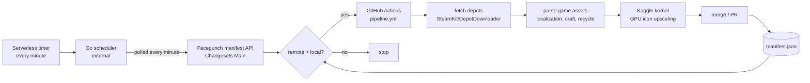

# Rust Game Icons

**A curated collection of high-quality PNG icons extracted from the Rust game.**

Hundreds of icons organised by category, plus item metadata: names in 31 languages, descriptions, crafting recipes and recycling yields. Useful for developers, modders, map makers, and anyone creating tools or documentation related to the game.

> 🔸 *Note:* The assets originate from the Rust game and are provided for convenience. They are not officially affiliated with or endorsed by Facepunch Studios. Please respect the game's licensing and intellectual property when using these icons.

---

## 📁 Repository Structure

Icons live in three format folders. Every item icon exists in all of them, with identical filenames and the same category subfolders inside:

| Folder | Format | Size | Use case |
|---|---|---|---|
| `large/` | PNG | 1080×1080 | AI-upscaled, max detail |
| `small/` | PNG | 180×180 | transparent background, close to the in-game art |
| `webp/` | WebP | 180×180 | lightweight, for web apps |

```
large/
small/
webp/
├── ammo/            pistol, rifle, rockets, arrows…
├── attire/          clothing and armor
├── components/      crafting components
├── construction/    building pieces
├── electrical/      circuits, batteries, lights…
├── food/            consumables
├── fun/             toys and seasonal items
├── items/           everything else
├── medical/         medkits, bandages, syringes
├── misc/            quest items, generic symbols
├── resources/       wood, stone, metal fragments
├── tools/           hammers, wrenches, jackhammers
├── traps/           bear traps, landmines, turrets
└── weapons/         guns, bows, melee weapons
```

Example path: `small/weapons/rifle.ak.png`.

Special folders, not included in `items.json`:

- `npc/` – 256×256 PNG portraits and avatars of in-game NPCs.
- `gui/` – 256×256 PNG, UI icons (gestures, etc.).

The category list is not exhaustive – explore the repository to discover every category.

---

## 📄 Data Files

| File | Schema | Content |
|---|---|---|
| `items.json` | [items.schema.json](.pipeline/schemas/items.schema.json) | Full item database: `id`, `image_name` (shortname), `category`, `name` = display name in every language the game ships (31 languages, synced from the game's own localization; missing → English). |
| `items.compact.json` | [items.compact.schema.json](.pipeline/schemas/items.compact.schema.json) | Same items, `name` limited to `en`, `zh-cn`, `ru` – the languages community tools need most. |
| `items.desc.json` | flat lookup | shortname → localized item description (all languages). Items without a description are not listed. |
| `items.craft.json` | flat lookup | shortname → crafting data from in-game recipes. **Every** item is listed, each record has the same field set (non-applicable → `null`/`false`/`0`/`[]`), see details below. |
| `items.recycle.json` | `items` lookup + `recyclers` block | shortname → recycling yields (inside `items`), plus the four recycler rates (see details below). |
| `manifest.json` | – | `{"version": N}` – the Rust build the repo was last parsed against. |

**`items.craft.json` fields** (per record): `craftable`, `craft_workbench` (`workbench1..4`, `null` = none), `amount`, `time`, `ingredients` (`[{item, amount}]`), `rarity`, `researchable`, `research_scrap` (Common 20 / Uncommon 40 / Rare 100 / VeryRare 300, default blueprints 10; `null` = unresearchable), `research_workbench` (`workbench1..3` or `iotable`; `null` = not in any tech tree), `research_blueprints` (own-node cost), `research_blueprints_techtree` (total cost from scratch incl. prerequisites), `default_blueprint`, `scrap_from_recycle`, `needs_steam_item`, `require_unlocked_item`, `additional_unlocks`, `force_time`, `stack_size`, `skin_of`, `despawn`.

**`items.recycle.json` recyclers:** `safe_zone` (Outpost/Bandit Camp – 40%, 8s), `monument` (green recyclers – 50%, 5s), `monument_powered` (same with power grid stage 2+ – 60%, 4.5s at stage 4), `power_plant` (red Power Plant recycler – 75%, 4s, needs power grid stage 4). A recycler breaks an item back into its recipe ingredients: each non-scrap ingredient returns `amount × efficiency / amountToCreate` units, whole units guaranteed, `chance` (0-1) = probability of one extra unit. `scrap` scales `scrap_from_recycle` by the recycler rate (base = 50%; fraction leftovers carry over to the next item). All values assume full condition; items that yield nothing are listed as `{"recyclable": false}`.

---

## ⚙️ How It Works

The repo is kept up to date by an automated pipeline. An external scheduler (a Go function on a serverless platform, running every minute) polls Facepunch's public manifest endpoint and compares the live Rust build number (`Changesets.Main`) with the one recorded in `manifest.json`. When the build is newer, it dispatches the GitHub Actions `pipeline` workflow, which does the heavy lifting on a GitHub-hosted runner:



Steps in the pipeline:

1. **Version gate** – re-checks the build number against `manifest.json` before spending anything.
2. **Fetch** – downloads the dedicated server and client depots (~4.7 GiB) via DepotDownloader.
3. **Parse** – `.pipeline/sync_all.py` refreshes localization, names, descriptions, craft and recycle data.
4. **Upscale** – new/changed icons are sent to a Kaggle kernel; RealESRGAN x4plus renders the 1080×1080 versions.
5. **Publish** – refreshed JSONs + icons land on `main`, or as a pull request.

The small `validate` workflow runs on every push to `main` and on PRs: it revalidates the JSONs against the [schemas](.pipeline/schemas) without needing game files or secrets.
